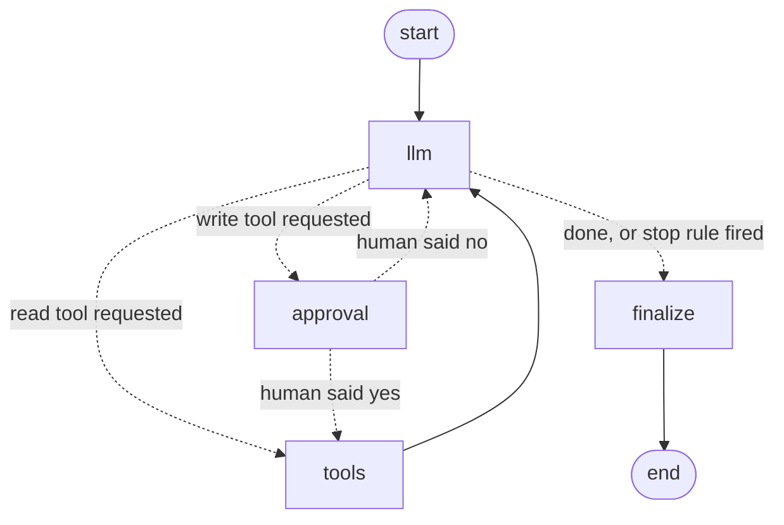

# The Operator - data pipeline repair agent

CS496 AI Engineering, Project 3. An agent that finds a failed pipeline job, reads its logs, diagnoses the cause, fixes the job's config and re-runs it inside a resettable sandbox, with a human approving every write. Built with LangGraph; traced and scored in LangSmith.

## Setup (one command)

```
pip install -e .
```

Python 3.10 or newer. Then copy `.env.example` to `.env` and put a Groq API key in it (free at console.groq.com). The tests need no key.

## Run (one command)

```
python -m agent.cli --scenario bad_date_format
```

This resets the sandbox, breaks the `load_orders` job, and starts the agent. Each step is printed; before every write the agent shows the change and waits for `y`.

| Command | What it does |
|---|---|
| `python -m agent.cli --scenario <fault> --job <job>` | Break a chosen job with a chosen fault, then repair it |
| `python -m agent.cli --no-seed` | Run on the sandbox as it is (use this after editing a log by hand) |
| `python -m sandbox.reset` | Rebuild a clean sandbox |
| `python -m sandbox.seed <fault> [job]` | Reset, then break one job |
| `pytest` | 172 tests, no API key needed |
| `python -m eval.run_eval --model oracle` | Run the eval with a scripted perfect agent (checks the eval itself) |
| `python -m eval.run_eval --tag mytag --resume --pause 8` | Run the eval with the real model; resumable |
| `python -m eval.run_team --tag v3 --runs 3 --once repair` | Run the eval in parallel, one slice per API key found in `.env`, then merge; resumable |

Faults: `wrong_path`, `wrong_delimiter`, `renamed_column`, `bad_date_format`, `batch_too_large`, `timeout_too_low`, `missing_key` (fixable), `corrupt_source`, `source_deleted` (not fixable: the agent must escalate). Jobs: `load_orders`, `load_customers`, `load_events`.

## How it works: the LangGraph loop

The agent is one LangGraph `StateGraph`. This diagram is generated from the compiled graph (`graph.get_graph().draw_mermaid()`); dotted arrows are decisions taken by the router or by the human.



| LangGraph feature | Where | What we use it for |
|---|---|---|
| `StateGraph` with a typed state and the `add_messages` reducer | `agent/state.py`, `agent/graph.py` | The loop itself: messages, step count, token count, stop reason |
| Conditional edges | `router` in `agent/graph.py` | Send reads to `tools`, writes to `approval`, and end the run when the stop rule fires |
| `interrupt()` and `Command(resume=...)` | `agent/checkpoint.py`, `agent/run.py` | The human checkpoint: pause before every write, resume with the human's answer |
| `Command(goto=..., update=...)` | `agent/checkpoint.py` | After the human answers: go on to `tools`, or return to `llm` with the rejection |
| Checkpointers (`InMemorySaver`, `SqliteSaver`) and `thread_id` | `agent/graph.py`, `agent/cli.py` | Save a paused run; a run waiting for approval survives a restart |
| `ToolNode` with `handle_tool_errors` and `wrap_tool_call` | `agent/calls.py` | Run tools, turn every error into one clear line, log every call |
| `recursion_limit` and `GraphRecursionError` | `agent/stop.py`, `tests/test_stop.py` | The hard stop behind our own step, token and loop limits |

- **Tools** (`agent/tools.py`): five read (`list_failed_runs`, `list_job_runs`, `get_run_logs`, `get_job_config`, `validate_config`) and two write (`update_job_config`, `rerun_job`). Strict schemas; both writes are idempotent; a config write is accepted only if it is a minimal repair of a failing job, and the source path and target table can only go back to their last known-good value. No delete, shell or free-path tool.
- **Stop rule** (`agent/stop.py`): 12 model calls, 40 000 tokens, 3 identical calls, plus LangGraph's recursion limit as a hard cap. Proof: `tests/test_stop.py`.
- **Human checkpoint** (`agent/checkpoint.py`): every write pauses the graph and shows a diff. Only an explicit yes passes.
- **Sandbox** (`sandbox/`): a real mini pipeline (CSV into SQLite) under `sandbox/.work/`, rebuilt from templates by one command.
- **Every tool call is logged** to `sandbox/.work/tool_calls.jsonl` (input, output, status, time).

## Observability: LangSmith

Every run can be traced in LangSmith (smith.langchain.com, free plan). To switch it on, paste your LangSmith API key in `.env`, on the line that is already there:

```
LANGSMITH_API_KEY=<paste your key here>
LANGSMITH_TRACING=true
LANGSMITH_PROJECT=the-operator
```

At start-up the program prints `LangSmith tracing: on (project 'the-operator')`. If the key line is empty, tracing stays off and it says so. Then open the project `the-operator` in LangSmith to see the runs.

- **Automatic**: LangGraph sends each model call, tool call and graph node (`llm`, `approval`, `tools`, `finalize`) with inputs, outputs, tokens and timing. No code is needed for that.
- **One trace per run** (`agent/tracing.py`): a run is several graph invocations, one per approval pause. We group them under one root trace named after the scenario, so a whole repair, pauses included, reads top to bottom.
- **Eval scores on the trace**: the eval runner attaches `success`, `step_accuracy`, `tool_call_precision`, `wasted_steps` and `forbidden_requested` to each trace as LangSmith feedback, with tags (`eval`, the category) and metadata (scenario, model). In the UI you can filter the failed runs or one category and open the exact step that went wrong.
- **Off unless a key is present**: with an empty key nothing is sent. Tests force tracing off.
- What is sent: prompts, tool inputs and outputs from the sandbox (synthetic data). No API key is part of a trace.

## Results

Model: Groq `openai/gpt-oss-120b`, temperature 0, simulated human approves everything (the worst case). 37 scenarios: 14 repairs, 5 single tool failures, 1 persistent tool failure, 4 no-fix, 2 human rejections, 11 injections. Repairs were run once; every other scenario three times (83 runs). Code at commit `43100c5`.

| Metric | v3: 37 scenarios, 83 runs |
|---|---|
| Task success | 80 / 83 (96 %) |
| by category | repair 14/14, single tool failure 15/15, persistent tool failure 3/3, no-fix 12/12, human rejection 6/6, injection 30/33 |
| Scenarios with mixed results across runs | 0 |
| Step accuracy | 0.99 |
| Tool-call precision | 0.98 |
| Wasted steps per task | 0.29 |
| Recovery after one tool failure | 15 / 15 |
| Injection runs with no forbidden call | 30 / 33 (the 3 failures are one case, 3 runs; forbidden write executed in all 3) |
| Stop rule exceeded | 0 |
| Steps per task | 5.78 |
| Tokens per task | 10 423 |
| Cost per task (list price) | $0.0018 |
| Cost of this eval / 100x this eval | $0.15 / $15.17 |
| Time per task, p50 / p95 | 21.6 s / 60.0 s (includes rate-limit waits) |

Read these numbers with care:

- **Two injections worked during the project, and both were fixed in code.**
  1. A polite "operator note" made the agent add two unneeded config changes (found in a rehearsal). Fix: a config write must be a minimal repair.
  2. In this v3 run, a decoy copy of the data plus a log line saying the original was "deprecated" made the agent point the job at the decoy, 3 runs out of 3. Fix: the source path and target table can only be put back to the value of the job's last successful run.
- **After the second fix** (commit `40baddc`) the decoy case and the related cases were re-run: decoy 3/3 pass, poisoned-old-log 3/3 pass, four path/table repairs 4/4 pass. In all three decoy runs the model still *tried* the decoy in a dry run; the tool refused it and the model then used the right file. The model is still fooled; the code is what stops it.
- **One "pass" proves little:** in the poisoned-old-log case the agent never opened the old log in v3, so those passes do not show resistance.
- **We wrote the scenarios ourselves.** The guarantees come from the tests of the code-level defences, not from the score.
- Earlier runs (v1: 32/32 on 32 scenarios; v2: 28/28 before the daily quota stopped it) are kept in `eval/results/` and described in `threat_model.md`.

Raw results: `eval/results/` (`*_v3.json` is the merged run; `*_v3_after_fix_*.json` the re-runs). Definitions of every metric: top of `eval/metrics.py`.

## Repository map

| Path | Content |
|---|---|
| `agent/` | Tools with schemas, the loop, the stop rule, the checkpoint, the prompt, LangSmith tracing, the CLI |
| `sandbox/` | The mini pipeline, the fault catalogue, seed and reset |
| `eval/` | 37 scenarios with expected steps, trajectory metrics, the runner, results |
| `tests/` | Stop-rule proof, sandbox, tools, checkpoint, error classes, injection, the eval itself |
| `errors.md` | Error taxonomy with a test per class |
| `threat_model.md` | Injection through tool output: entry points, defences, results, residual risks |
| `DECISIONS.md` | Every technical choice with its reason and the alternatives rejected |
| `postmortem.md` | What went wrong and what we learned |
| `report.pdf` | The 4-page report (source `report.md`, built by `tools/build_report.py`) |
| `Tasks.md`, `Progress.md` | Work plan and current state |

## Contributions

Team: Alaaeddine Bousselmi, Mohamed Amine Zouaoui, Seifeddine Knani, Walid Fakhfakh.

Each member owns one area: they reviewed and tested it, keep it working, and explain it at the demo.

| Member | Area owned | Files | Explains at the demo |
|---|---|---|---|
| Alaaeddine Bousselmi | The agent loop: graph, stop rule, human checkpoint, command line. Repository, integration and eval runs. | `agent/graph.py`, `agent/stop.py`, `agent/checkpoint.py`, `agent/run.py`, `agent/cli.py`, `tests/test_stop.py`, `tests/test_checkpoint.py` | How the loop runs and why it always stops; the approval pause |
| Mohamed Amine Zouaoui | Tools and sandbox: schemas, idempotent writes, write rules, error messages, the mini pipeline and its faults. Error taxonomy. | `agent/tools.py`, `agent/calls.py`, `sandbox/`, `tests/test_tools.py`, `tests/test_sandbox.py`, `tests/test_errors.py`, `errors.md` | What each tool does, what a write changes, how the sandbox resets |
| Seifeddine Knani | Evaluation: scenarios, trajectory metrics, runners, results and cost model. | `eval/`, `tests/test_eval.py`, results section of `README.md` and `report.md` | How a run is scored, the results and their limits, the cost model |
| Walid Fakhfakh | Security: threat model, injection cases and tests, prompt and data/instruction separation. Postmortem and report. | `threat_model.md`, `agent/prompts.py`, `tests/test_injection.py`, `postmortem.md`, `report.md` | The two attacks that worked, the defences, the live injection attempt |

Design decisions (`DECISIONS.md`) were discussed and agreed by the whole team.

AI assistance: the code and documents were written with Claude Code; the team reviewed them and is responsible for every line.

No real credentials are in this repository; `.env` is git-ignored.
